# Decision models, meet the document pile

KONRAD BANACHEWICZ · [publication date to set]

*Companion Substack post plan — based on the completed notebook, not a new inference experiment.*

Evidence anchor: `evaluation-20261030T222218Z`, with pilot `pilot-20261030T213827Z`. Numeric claims below describe that captured run; refresh them if the notebook is later used for a different experiment.

Editorial brief: take the reader from curiosity about decision models to a controlled local RAG-retrieval test. Explain what changes at each rung, show the measured results, and let the disappointing efficiency comparison be part of the story. Target roughly 1,800–2,400 words when drafting. Follow `post-guide.md`: short paragraphs, practitioner voice, equations followed by plain English, restrained dry humor, a reading after every visual, and the exact `Closing time` heading.

**Revision after independent critique:** keep the four-method experiment and every numbered placeholder. Describe system replacements rather than claiming causal isolation of decision-model architecture. Include the tied-score and duplicate-text diagnostics below. The critique, evidence checks and accepted/rejected changes are documented in `docs/post-plan-critique.md`.

**Pacing plan:** Graphs **2, 5, 8 and 10** carry the central story. Keep the other eight placeholders as supporting insets with short readings; link to the full notebook when expanding operational details. Do not repeat all metrics in both prose and tables. Suggested body budgets, including visual readings: hook 130 words; setup 60; corpus 100; BM25 100; judge 130; navigation 130; control 140; protocol/metrics 170; results 230; C/D interpretation 180; diagnostics 240; closing 130. Keep captions around 250 words total. Condense the old timer and 259-query-design history to one reproducibility note. Filename bookkeeping below is editorial metadata, not article prose.

Publication title and any episode number are editorial decisions still to make. Do not invent a Time Series episode number or a GitHub URL. Replace the local notebook link below with its verified public URL before publishing. Header artwork is optional at this planning stage; do not add an image that implies a measured result.

**Opening plan, 2–4 paragraphs with no section header:**

I've been hearing about decision models for a while. Models built to make bounded judgments sound useful—but I wanted to see what the big deal was once we put one to work. A new paper, *[Retriever-Free Retrieval: Navigating Documents with Decision Models](https://arxiv.org/abs/2610.35868v1)*, offered a practical excuse. Let's take the idea for a test drive.

Retrieval matters because a RAG generator can only use the evidence we hand it. If retrieval misses the relevant passage, a better generator does not fix that missing input. The paper proposes navigating a document hierarchy through relevance decisions. We will try a small version locally, using Ollama.

**Compare adding a judge, changing discovery and replacing the model that makes the judgments.** Preview the ladder: BM25 → BM25 plus Nimble judging → Nimble page/passage navigation → ordinary Qwen under the same controller. These are practical pipeline comparisons, not clean causal decompositions. Promise practical understanding rather than a full benchmark reproduction. No promised winner; that would make the experiment rather easy ;-)

📓 All code lives in the companion notebook:
[decisionrag_ollama_demo.ipynb](decisionrag_ollama_demo.ipynb)

## Run the notebook

Keep this as a short reproducibility box in the article. The delivered notebook replays saved inference traces, recomputes metrics and intervals, and writes `./graphs` without new model calls. A fresh live run uses `CFG.mode = 'evaluate'`, two explicit Q8 models and a three-hour workflow cap. The corpus and tokenizer download separately and are verified before reuse. Link the notebook for installation details rather than pasting the entire setup into the article.

The original live notebook took **107.1 minutes**; evaluation itself took **60.2 minutes**. The captured environment records **macOS arm64, Ollama 0.40.13**, and both roughly 9B Q8_0 models resident. Those times describe this setup, not a promise for every laptop. The run receipt does not capture CPU model or RAM capacity; verify and label those before publishing a hardware-specific feasibility claim. Do not present replay runtime as inference speed. The notebook and post share the headings below. Visual numbering includes tables; `0111` is literal, so the first table is `post_3_0111.png`.

## A small corpus, chosen before the queries

Introduce [MultiDoc2Dial](https://doc2dial.github.io/multidoc2dial/) in one sentence: conversations grounded in archived US government help pages. Explain the units—pages, structural passages, conversations and annotated evidence—before introducing scores.

Walk through selection in order: hash-select eight pages per domain; keep every passage on those pages; choose eligible training and validation dialogues with in-corpus gold evidence. We search **32 pages / 329 passages**, pilot on **eight training dialogues**, and evaluate **twelve distinct validation dialogues**, three per domain. The corpus was chosen before the queries, and model outcomes did not select the evaluation questions. Explain the annotation-conditioned eligibility and exclusions: useful restricted task, not a random sample of all retrieval problems or the paper's full benchmark.

> **[Insert Graph 1 here — corpus and frozen cohorts]**

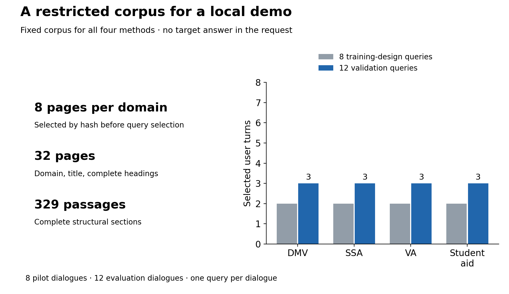

*Proposed caption:* Every method searches the same 32 pages and 329 complete passages. The training pilot has two queries per domain; validation has three.

*Reading to write:* The balance makes the design easy to inspect. It does not make twelve queries representative. Archived government pages are benchmark evidence, not current administrative advice.

## BM25: give keywords the first turn

Introduce **BM25** as the fast lexical baseline A. Explain frequency saturation, rare-term weighting and length normalization. Reuse the notebook's BM25 equation and unpack every symbol immediately; the article can omit the equation if it interrupts the promised level. Explain $k_1=1.5$, $b=0.75$, and what higher/lower values change. These are fixed settings, not tuned on validation outcomes.

Specify the inputs: retained conversation history against title, headings and full passage text, Unicode word tokens, case folding, no stemming or learned embedding model. Motivate the next rung with vocabulary mismatch, without asserting BM25 must lose. No separate image here: Graph 2 will show all four paths together.

## Add a judge

Introduce **Nimble** and option B: BM25 finds fifty candidates, then the model judges whether each would help answer the request. Explain that this can improve ranking without changing initial lexical discovery. Evidence outside the first fifty still cannot be recovered. Reuse the notebook's simple score equation, translated immediately into a sentence.

Define the subject before the plumbing: in this demo, a decision model specializes in bounded judgments and exposes native choice scores. Nimble supplies binary relevance scores; the ordinary Qwen control generates a JSON object of relevance scores. The paper's specialized shared-forward serving is a separate efficiency mechanism that we do not reproduce. We perform no MultiDoc2Dial fine-tuning; that does not mean the supplied Nimble model lacks prior decision training.

Explain shared candidate context and bounded prefix rescoring. The output is a ranking score; do not advertise demonstrated probability calibration. Keep the low-level prompt/schema code in the notebook. Mention that full candidate text stays intact and document text is treated as data.

## Let the judge navigate

Introduce option C as a second change: score all page metadata, retain three pages, rank all their passages, return ten. Use the notebook's four mechanism steps. Fewer pages save work but can prune the evidence; more pages add cost. The three-page budget was frozen, not chosen because it won this test.

Include a tiny implementation sketch, without another figure: `conversation → score page metadata → keep 3 pages → score their passages → return 10`. B/C compares two complete discovery-and-ranking strategies using Nimble; candidate pools and compute change, so it does not isolate hierarchy alone at equal work.

Be explicit about adaptation versus replication: no task-specific training in this demo; no help-center router, retrieval memory, Jev serving or guarantee of one shared forward pass. We keep the paper's hierarchy mechanism, with sixteen-candidate states, four relevance questions per request, and a bounded twelve-item prefix rescore. Do not repeat the paper's hosted latency as a local expectation.

## A decision model versus an ordinary LLM

Introduce D: ordinary **Qwen3.5 9B Q8_0** generates numeric relevance scores under the same controller. Nimble is also 9B Q8_0 from the same model family, but weights, training, adapter and serving behavior differ. Generated Qwen scores are not calibrated probabilities.

> **[Insert Graph 2 here — the four retrieval paths]**

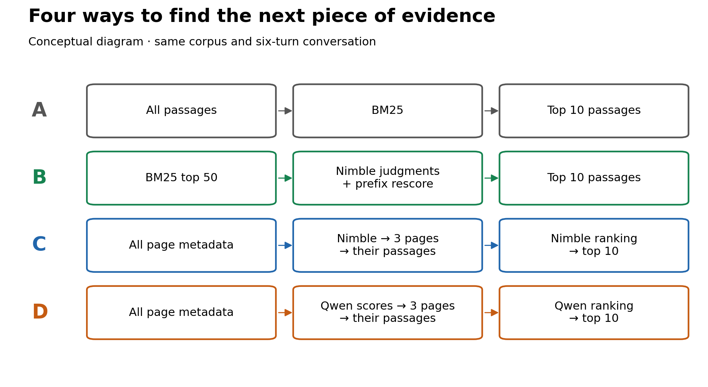

*Proposed caption:* A→B adds the Nimble judging/rescoring pipeline; B→C changes discovery and its workload; C→D replaces the model and scoring adapter under common navigation rules.

*Reading to write:* C/D tests a practical end-to-end replacement, not decision-model architecture or training in isolation. It starts from the same corpus and rules, but the models choose different pages and therefore different passage pools. C made **275** scored requests and D **235**, with no retries; that workload difference is part of the result, not evidence of unfairness. C beating BM25 alone would not answer whether a specialized decision model was responsible. The paired latency result is not a per-decision speed comparison.

## Keep the test honest

Describe the visible workflow: verify downloads and corpus → freeze inputs and knobs → check both backends and context → pilot on training data → check budget → evaluate all four methods on the same twelve queries → inspect failures and uncertainty. No answer text or gold labels enter model prompts. Both models must remain resident.

> **[Insert Table 3 here — the experiment contract]**

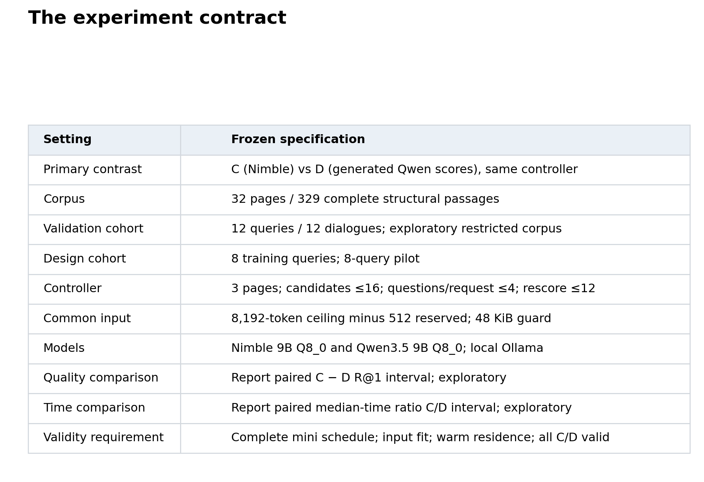

*Proposed caption:* The models, corpus, candidate limits, context limits and comparison were declared before evaluation.

*Reading to write:* Up to sixteen complete candidates share a state, but at most four questions are asked in one request for either adapter. Context overflow fails visibly; it does not silently shrink evidence. The guard targets a development failure, not a new performance claim.

Explain the earlier timer problem briefly: active time missed large wall-clock gaps, motivating stricter wall/monotonic deadlines and a clock audit. The completed run passed that audit. Explain that C/D run before A/B to avoid B priming Nimble; cross-sweep latency comparisons remain descriptive. Training-only adapter and repeat probes do not become extra evaluation methods.

> **[Insert Graph 4 here — pilot feasibility forecast]**

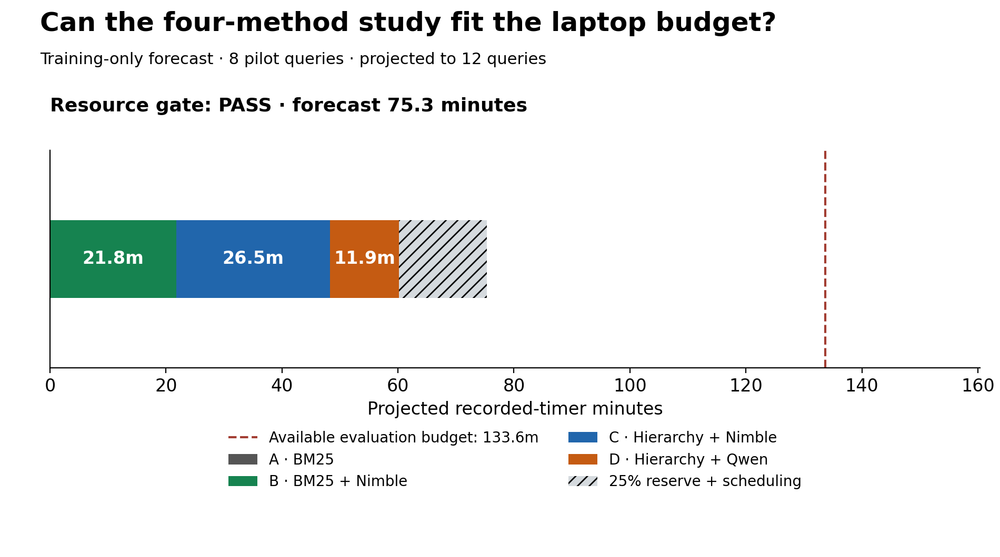

*Proposed caption:* The training pilot forecast **75.3 minutes** for evaluation, including reserve, against **133.6 minutes** remaining.

*Reading to write:* The complete pilot authorized evaluation. Distinguish its prediction from the subsequent **60.2-minute** evaluation and **107.1-minute** full notebook run. Downloads and offline plotting sit outside the inference workflow cap.

### What counts as a useful retrieval?

Define strict passage-ID Recall@1, @5 and @10 with the notebook's indicator equation, followed by plain English. One question asks whether the first passage is correct; another asks whether the evidence reached a ten-passage bundle. We do not evaluate generated answers. Retain the exact-text sensitivity caveat for duplicate structural passages.

Explain failures as misses, unattempted queries as unattempted, and full-query timing boundaries. Uncertainty uses 10,000 paired whole-dialogue draws within domain. Three dialogues per domain mean broad exploratory intervals. Our original local 259-query design is a separate, larger experiment, not the paper's full benchmark. Do not turn a failed noninferiority test into proof of inferiority, or equal point estimates into equivalence.

State what the intervals omit: they resample dialogues/queries from **one captured run**, not repeated executions, different laptops or other serving configurations. Request groups within a query are not additional independent evaluation examples.

## What happened on the laptop?

Start with the actual completed schedule: **32/32 pilot** and **48/48 evaluation** method-query combinations valid. Separate execution success from retrieval success. The interesting turn is that the more elaborate method did not win every comparison.

> **[Insert Graph 5 here — retrieval accuracy]**

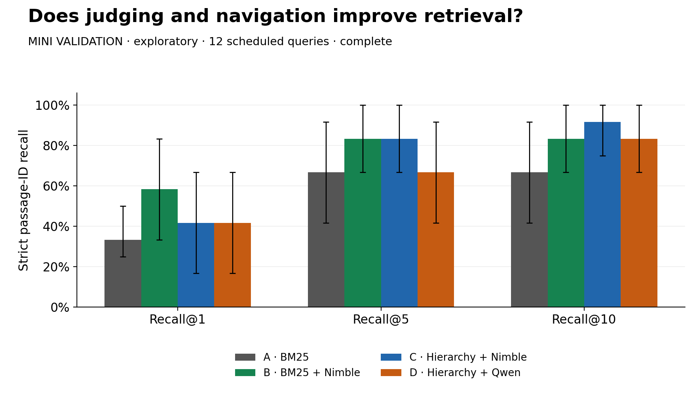

*Proposed caption:* On twelve queries, strict Recall@1 was A **33.3%**, B **58.3%**, C **41.7%**, D **41.7%**. Recall@10 was **66.7%, 83.3%, 91.7%, 83.3%** respectively. Intervals are exploratory.

*Reading to write:* The observed A < B < C story fails at rank one. B found seven correct first passages; A found four; C and D found five each. C's eleven-of-twelve Recall@10 is useful evidence about the bundle, but does not rescue its first-choice comparison. Avoid calling B statistically superior from point estimates alone.

Add the existing sensitivity result in one sentence: exact normalized-text matching gives **A 4/12, B 7/12, C 6/12, D 6/12** at rank one. Both hierarchies have one top-ranked text match with a different structural ID. Keep strict-ID recall primary; this sensitivity does not change the C/D tie or create an efficiency win.

> **[Insert Table 6 here — four-method results]**

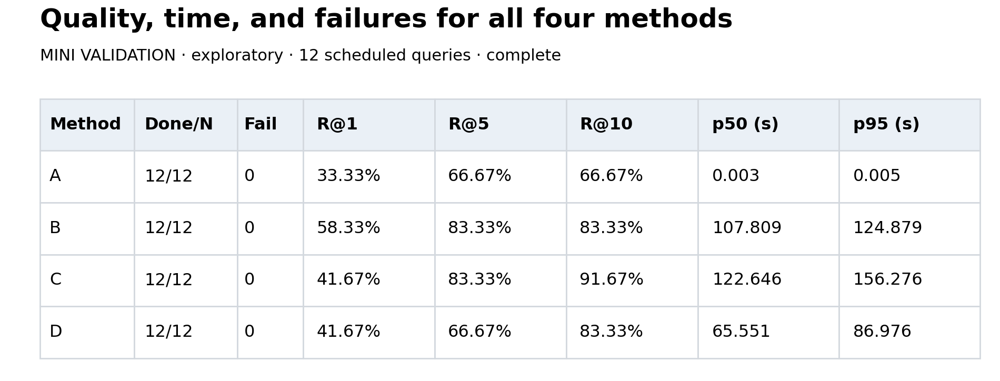

*Proposed caption:* Completed counts, failures, strict recall and original full-query timings for all four methods.

*Reading to write:* Median seconds were A **0.003**, B **107.809**, C **122.646**, D **65.551**. BM25's speed is in milliseconds, not zero seconds. Judging improved observed rank-one recall here while adding substantial latency. No metric includes answer generation.

> **[Insert Graph 7 here — quality and latency]**

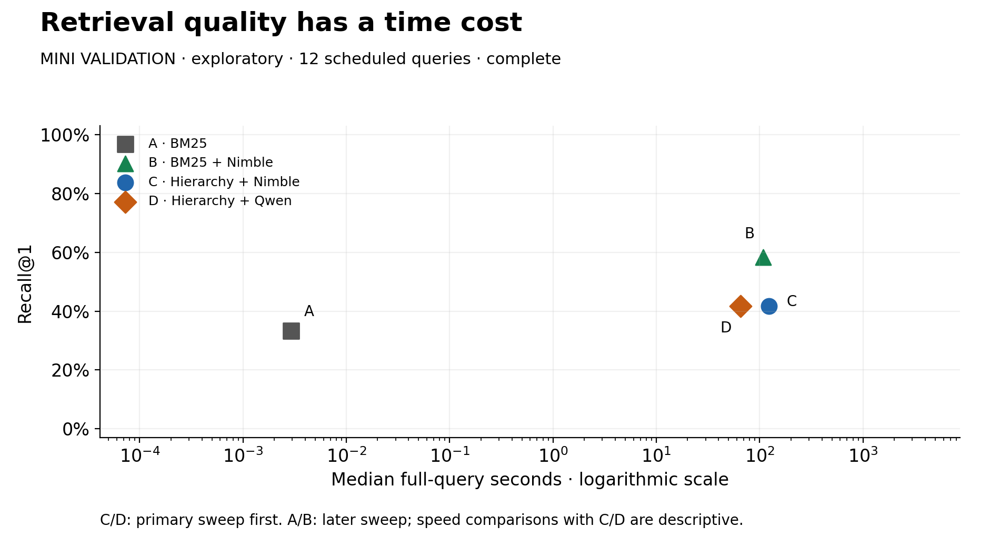

*Proposed caption:* Median full-query latency against Recall@1; logarithmic time axis.

*Reading to write:* Left is faster and higher is better. B has the strongest observed Recall@1; C adds time without a first-choice improvement over D. Cross-sweep A/B versus C/D timing comparisons are descriptive. This is a local engineering tradeoff, not a price/performance benchmark for the hosted paper system.

## Does the decision model earn its place?

Return to the original curiosity. On this test, the decision model did not demonstrate the expected efficiency advantage. Its hierarchical Recall@1 matched Qwen's point estimate, with considerable uncertainty, while the local interface took longer.

> **[Insert Graph 8 here — paired Nimble/Qwen comparison]**

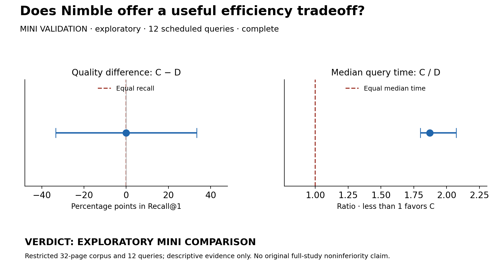

*Proposed caption:* C−D Recall@1 difference **0.0 percentage points**, 95% interval **−33.3 to +33.3**; median-time ratio C/D **1.87**, 95% interval **1.80–2.07**.

*Reading to write:* Nimble took about 1.87 times as long in median query time, including its different realized navigation workload. Equal observed quality does not establish equivalence. The interval resamples the twelve dialogues in one run; it does not quantify repeated-run or hardware variability. This local result does not disprove the paper's shared-forward serving results or establish that every decision model is slow.

> **[Insert Table 9 here — verdict and validity]**

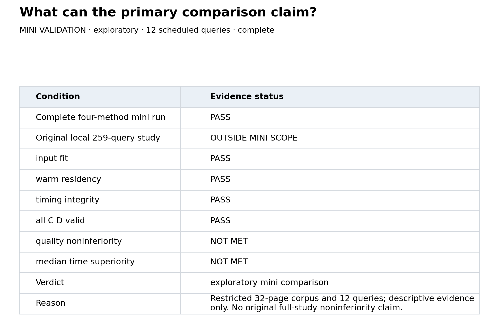

*Proposed caption:* The mini run completed and passed execution-validity checks. Our original local 259-query study remains outside scope; no confirmatory efficiency win is claimed.

*Reading to write:* Operationally valid and scientifically conclusive are different properties. “Exploratory mini comparison” is the correct verdict, including the negative result.

## Where did the hierarchy lose the answer?

Use diagnostics to explain what happened rather than inventing a post hoc tuning success. Do not change the frozen controller based on these twelve outcomes and keep calling the cohort held out.

> **[Insert Graph 10 here — navigation versus ranking failures]**

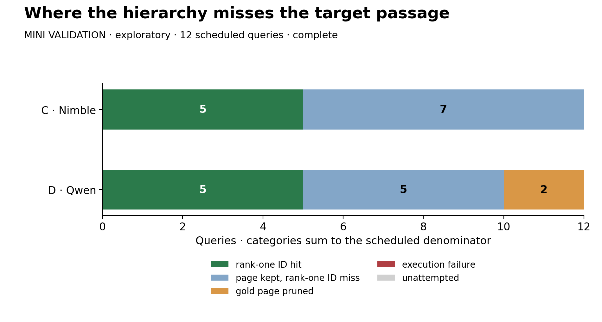

*Proposed caption:* Under strict structural-ID scoring, Nimble retained the gold page on all twelve queries but missed the target ID at rank one seven times. Qwen pruned the gold page twice and had five retained-page rank-one ID misses.

*Reading to write:* Better page retention and better first-passage selection are separate things. Both models had five strict-ID first-choice hits through different failure patterns. One ID miss per model still matched the normalized target text, so do not describe every ID mismatch as semantically losing the evidence.

**Required scoring diagnostic, no extra visual:** among successful request groups with at least two scores, Qwen returned all-equal scores in **177/234 (75.6%)**, and had some tie in **231/234**. Nimble C had **0/273** all-equal or tied groups. Singleton groups are excluded because equality there is automatic. The frozen `sorted_scores` function breaks equal scores by candidate ID, so tied parts of Qwen's ranking use that deterministic fallback. These are request-group counts, not 234 extra queries. Many groups may contain genuinely irrelevant candidates: ties alone do not prove wrong scores, explain the speed difference, invalidate D, or show what an alternative Qwen prompt would achieve. They limit claims about ordinary LLMs beyond this particular numeric-score adapter. Preserve the observed result and do not tune the interface on this held-out cohort.

> **[Insert Table 11 here — domain inspection]**

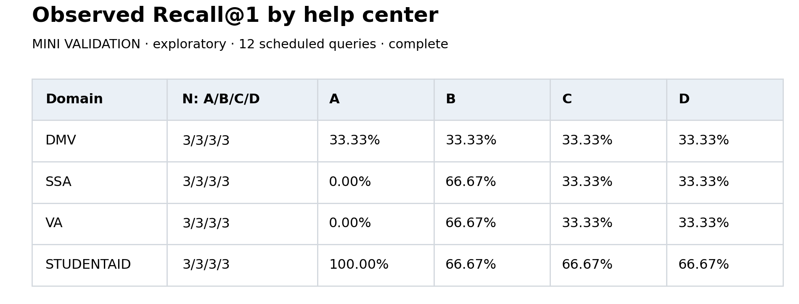

*Proposed caption:* Four domains, three validation queries per domain; all methods use the same questions.

*Reading to write:* One changed answer moves domain recall by 33.3 points. Treat this as an aid for inspecting examples, not evidence for a domain-specific deployment rule.

> **[Insert Graph 12 here — latency distributions]**

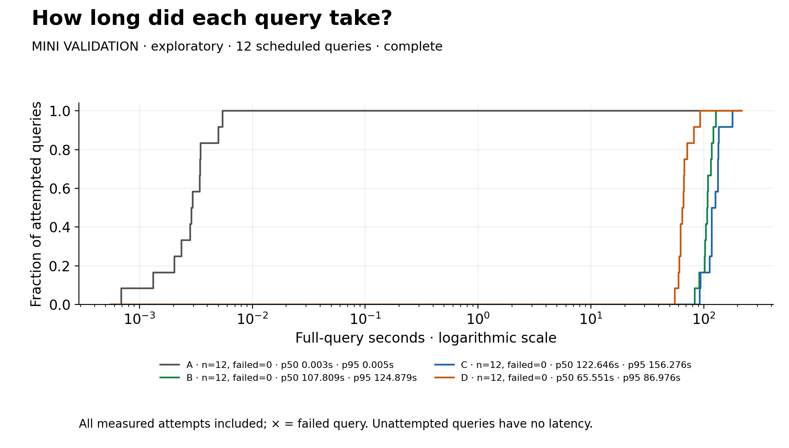

*Proposed caption:* All attempted query times, including any failures; curves reproduce original inference durations.

*Reading to write:* The distribution exposes the slower queries a median hides. Report the boundary consistently: these are retrieval timings, not token throughput or total RAG answer latency. The plotting runtime is irrelevant to model speed.

## Closing time

Recap three pipeline comparisons: adding judging/rescoring, changing discovery, and replacing the model-plus-adapter implementation. State the observed outcome without dressing up the loss: B had higher observed Recall@1 than BM25; Nimble hierarchy had the highest observed Recall@10, but not the strongest first choice; its end-to-end latency was higher than this ordinary-Qwen score adapter under the same controller rules. Twelve queries leave substantial quality uncertainty. Tied Qwen scores and different branch workloads qualify the interpretation; they do not erase the result.

Close with the useful RAG lesson: inspect where evidence disappears and measure the entire retrieval decision process. Complexity has to earn its cost. A larger follow-up needs new frozen queries, a broader corpus, a modern dense baseline and a separate serving-efficiency experiment. Test any alternative ordinary-LLM ranking interface on training data before freezing that new evaluation; use identical candidate states and repeated runs for a separate per-decision serving experiment. This notebook did not reproduce the paper's hosted execution, evaluate answer quality, or establish general decision-model superiority.

Keep the final paragraph conversational, with one dry aside at most. No victory lap for a result we did not obtain.

United States of Banan is a reader-supported publication. To receive new posts
and support my work, consider becoming a free or paid subscriber.

[ ✓ Subscribed ]
