# Decision models, meet the document pile

*A local test of judging, document navigation, and the cost of putting a language model in charge of retrieval.*

KONRAD BANACHEWICZ

I've been hearing about **decision models** for a while. A model built to make bounded judgments sounds useful, but I wanted to find out what the big deal was once we gave it a job. Then I came across *[Retriever-Free Retrieval: Navigating Documents with Decision Models](https://arxiv.org/abs/2610.35868v1)*, and there was our excuse. Let's take one for a test drive.

The job is retrieval. In **retrieval-augmented generation**, or RAG, we fetch evidence and hand it to a model to help construct an answer. Miss the relevant passage, and the generator has to proceed without it. That makes retrieval a sensible place to test a model that specializes in deciding what matters.

**Compare adding a judge, changing how we discover evidence, and replacing the model making those judgments.** We'll start with BM25, add a Nimble judge, let Nimble navigate pages and passages, then give ordinary Qwen the same navigation job. The goal is practical understanding. The most elaborate pipeline is allowed to lose. Conveniently, it cooperated ;-)

📓 All code lives in the companion notebook:
[decisionrag_ollama_demo.ipynb](decisionrag_ollama_demo.ipynb)

<!-- Before publication, replace the local notebook link with its verified public URL. -->

## Run the notebook

The notebook opens in replay mode: Run All recomputes the saved results and exports the figures without calling a model. To run fresh inference, use `CFG.mode = 'evaluate'` with local Ollama and the two specified models. Corpus and tokenizer downloads are separate.

The original run used macOS arm64 and Ollama 0.40.13, with both roughly 9B Q8_0 models resident. Its timings describe this setup; they are not a promise for every laptop.

## A small corpus, chosen before the queries

We use **[MultiDoc2Dial](https://doc2dial.github.io/multidoc2dial/)**: conversations grounded in archived government help pages, covering driving, Social Security, veterans' benefits and student aid. Each query contains conversational context, with an annotated passage supporting the next reply.

We hash-select eight pages per domain, keep every passage on those pages, then select queries whose evidence falls inside that corpus. That gives us **32 pages, 329 passages, eight training pilot queries and twelve validation queries**, each from a distinct dialogue. Validation excludes previously explored dialogues and our original larger local evaluation cohort.

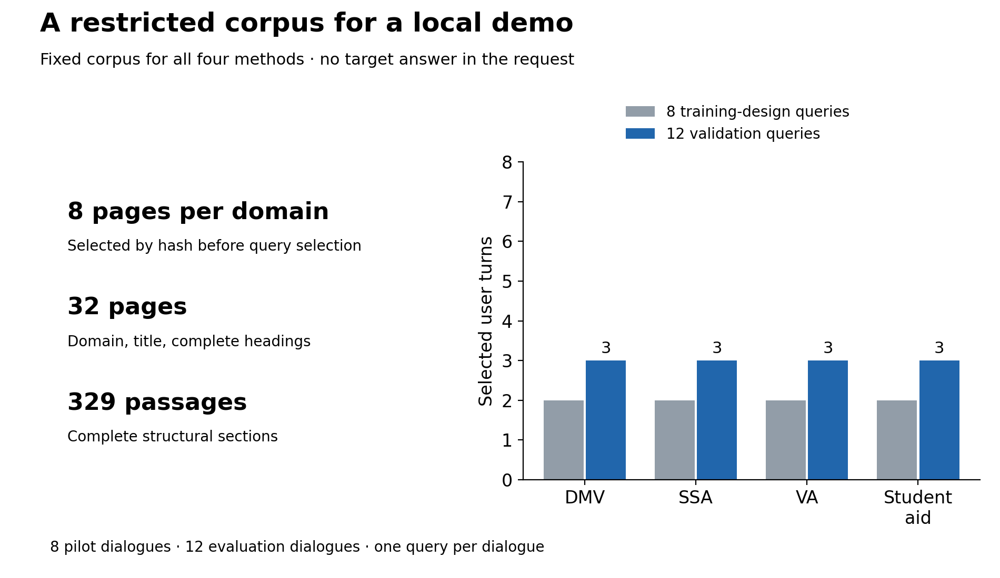

*Graph 1. Every method searches the same corpus; validation contains three queries per domain.*

The corpus was selected before the queries, without consulting model outcomes. Requiring evidence inside it still makes this a restricted task. Its scores cannot be compared directly with the paper's full benchmark. The archived pages are evidence for an experiment, not current administrative advice.

## BM25: give keywords the first turn

Our baseline, **A**, is **BM25**. It rewards matching terms while accounting for how rare they are, how often they appear and how long the passage is. Repeating one word eventually stops helping much; writing a longer passage does not automatically win.

We search titles, headings and complete passage text using the retained conversation history. Preprocessing is deliberately plain: Unicode word tokens, case folding, no stemming.

We fix $k_1=1.5$ and $b=0.75$. Higher $k_1$ lets repetition matter for longer; higher $b$ increases length normalization. A returns ten passages. Its obvious vulnerability is vocabulary mismatch: the user and the document may describe the same thing differently.

Can we improve that ranking?

## Add a judge

Option **B** keeps BM25 for discovery, then asks **Nimble** whether each of the first fifty passages would help answer the request.

Here, a decision model specializes in bounded judgments and exposes native choice scores. Nimble supplies a binary relevance score. We use that score to rank passages; we have not demonstrated that it is a calibrated probability of retrieval success.

The model sees the conversation and several candidates together. We rank its scores, then jointly rescore a bounded leading prefix. This tests adding the judging-and-rescoring pipeline to BM25. It cannot recover evidence outside BM25's first fifty candidates.

We do no MultiDoc2Dial fine-tuning. Nimble arrives with prior decision training, which is rather the point of trying a specialized model.

One distinction matters already: the paper's shared-forward execution is a serving mechanism, separate from asking a model relevance questions. Our local interface does not establish that execution behavior.

## Let the judge navigate

Why let BM25 choose the candidates at all?

Option **C** asks Nimble to rank page metadata: domain, title and headings. We keep three pages, score every passage on those pages, and return ten passages.

The implementation fits in one line of thought:

```text
conversation → score page metadata → keep 3 pages → score their passages → return 10
```

A smaller page budget saves work but risks pruning the answer before passage ranking begins. A larger one gives the passage judge more opportunities—and more work. We fixed three pages before evaluation.

B/C therefore compares two discovery-and-ranking strategies using Nimble. Candidate pools and compute change; we are not isolating hierarchy at equal work.

This is a small adaptation of the paper's navigation idea. We omit help-center routing and retrieval memory, and do not reproduce the specialized serving used by its Jev decision model.

## A decision model versus an ordinary LLM

Now for the control that makes the exercise interesting.

Option **D** gives **Qwen3.5 9B Q8_0** the same navigation rules, but asks it to generate structured numeric relevance scores. Nimble is also a 9B Q8_0 model from the Qwen3.5 family. We match size class and quantization, while their training and interfaces differ.

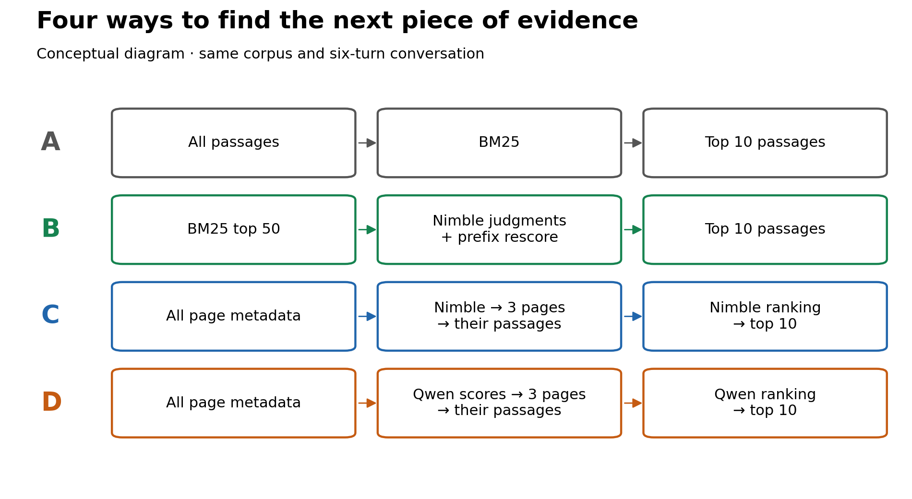

*Graph 2. A/B adds judging; B/C changes discovery; C/D replaces the model and scoring adapter.*

C/D starts with the same corpus and controller, but the models can choose different pages. Their downstream passage pools and workloads therefore differ. This is a useful end-to-end comparison of two implementations. It cannot tell us how much of a difference comes from specialized training, scoring interfaces or serving behavior alone.

Qwen's generated scores are ranking values, not calibrated probabilities. Neither method generates the final answer.

## Keep the test honest

We freeze the corpus, queries, parameters and schedule before evaluation. Gold passage IDs and reference answers stay outside model inputs. Eight training queries supply the pilot; the twelve validation dialogues supply the comparison.

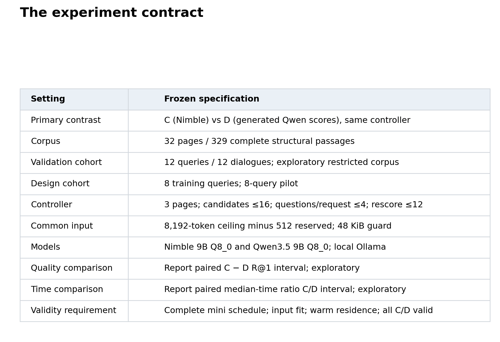

*Table 3. Shared limits and declared settings for the four-method experiment.*

Up to sixteen complete candidates share a state, but both adapters receive at most four questions per request. Inputs must fit the common context limit. A failed gate stays a failure rather than quietly shortening the evidence.

C/D runs before A/B to avoid B priming Nimble's cache for C; order within each query pair is seeded. Speed comparisons across those two sweeps remain descriptive. An earlier clock-gap problem also led us to enforce both wall and monotonic deadlines; this run passed the timing audit.

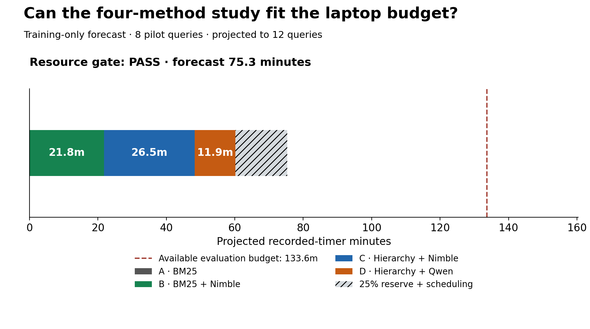

*Graph 4. The pilot forecast 75.3 evaluation minutes, including reserve, against 133.6 minutes remaining.*

Evaluation subsequently took **60.2 minutes**, and the whole live notebook took **107.1 minutes**, within its three-hour cap. Downloads and offline plotting sit outside that allowance. The forecast authorized the experiment; it was not another measured result.

### What counts as a useful retrieval?

We measure **strict passage-ID Recall@k**: did the annotated structural passage appear among the first $k$ results?

$$
R@k = \frac{\text{queries with the target passage in the first }k\text{ results}}{\text{evaluated queries}}.
$$

Recall@1 checks the first choice. Recall@10 checks whether a ten-passage bundle contains the evidence. Neither measures generated-answer quality.

Execution failures count as misses; unattempted queries remain separate. Query timings include admission checks and any retries or loading inside the query. Uncertainty comes from 10,000 paired whole-dialogue resamples within domain, using one captured run. Those intervals do not describe repeated-run or hardware variability.

## What happened on the laptop?

All **32 pilot** and **48 evaluation** method-query combinations completed successfully. The machinery ran. Did it retrieve the right evidence?

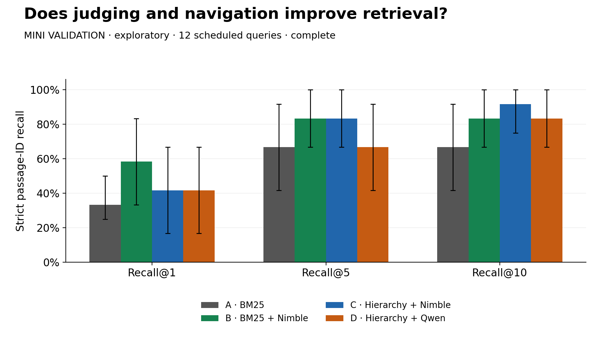

*Graph 5. BM25 plus Nimble has the highest observed Recall@1; Nimble hierarchy has the highest Recall@10.*

B found the annotated passage first on **seven of twelve** queries. BM25 managed four; the two hierarchies managed five each. The hoped-for A < B < C ordering did not appear at rank one.

Nimble hierarchy did put the target somewhere in its top ten on **eleven of twelve** queries. That is useful evidence about the bundle, but it answers a different question from choosing the best first passage. With twelve queries, these are exploratory observations, not established population rankings.

There is also a label sensitivity: normalized-text matching gives A/B/C/D **4/12, 7/12, 6/12 and 6/12** at rank one. Each hierarchy has one text match carrying a different structural ID. Strict-ID recall remains primary.

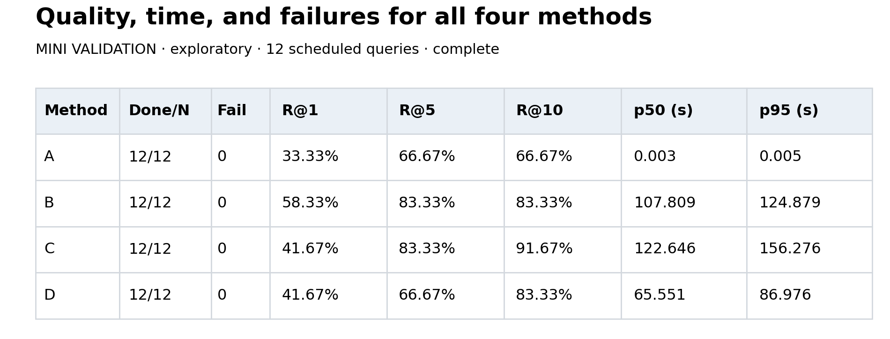

*Table 6. Quality, completion and original full-query latency in one place.*

The cost of judging is hard to miss: BM25's median is about **three milliseconds**, versus roughly **108 seconds** for B. It had lower observed Recall@1, but it also did considerably less work. No time here includes answer generation.

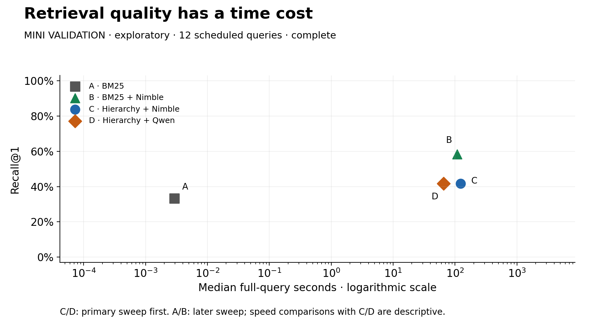

*Graph 7. Higher is more accurate at rank one; farther left is faster.*

The log axis lets milliseconds and minutes share a picture. C sits to the right of D without a higher observed Recall@1. That brings us back to the decision model's proposed advantage.

## Does the decision model earn its place?

**This local implementation did not demonstrate an efficiency advantage for Nimble.**

Its hierarchy took a median **122.6 seconds** per query, versus **65.6 seconds** for Qwen. Both had strict Recall@1 of 41.7%.

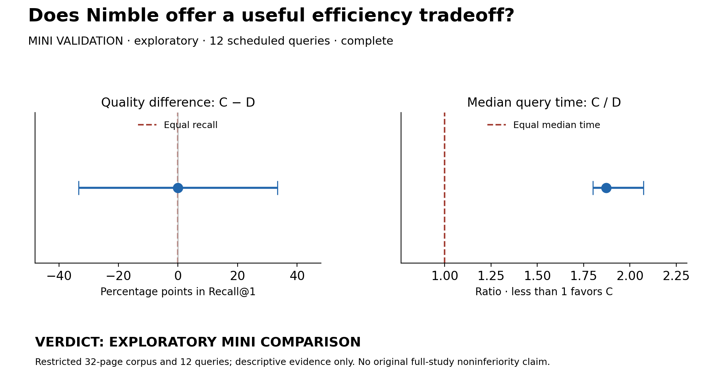

*Graph 8. Quality difference: 0.0 points, 95% interval −33.3 to +33.3. Time ratio: 1.87, interval 1.80–2.07.*

Nimble took about **1.87 times as long** in median query time. Equal observed recall does not establish equivalent quality; the broad interval makes that clear.

The workload also matters. C made **275** scored requests, D **235**, with no retries. Different selected branches are part of this end-to-end result, so the ratio is not a per-decision serving-speed comparison. Its interval resamples these twelve dialogues, not repeated executions.

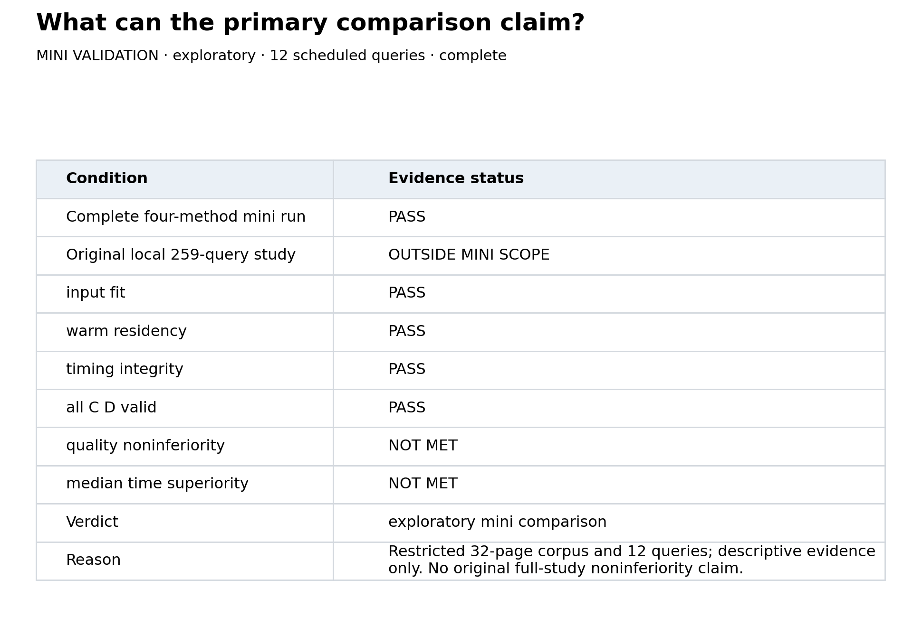

*Table 9. A completed, operationally valid mini run still supports an exploratory verdict.*

Our larger local 259-query design was not run; it is also distinct from the paper's benchmark. We cannot turn passing execution checks into a confirmatory quality claim—or a local speed loss into a conclusion about every decision model.

## Where did the hierarchy lose the answer?

The two models reached the same first-choice score through different failure patterns.

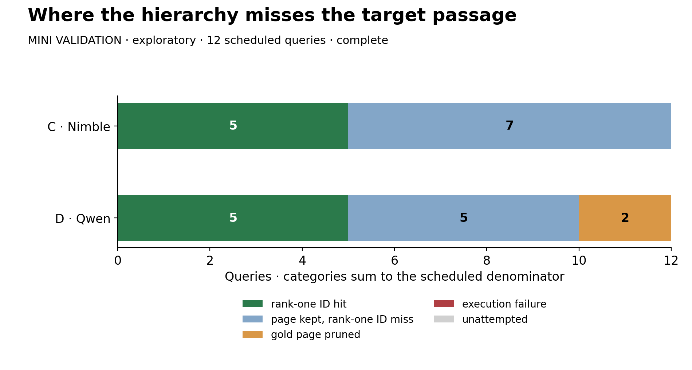

*Graph 10. Page retention and passage ranking are separate opportunities to miss the annotated target.*

Nimble retained the gold page on all twelve queries, then missed its passage ID at rank one seven times. Qwen pruned the gold page twice and had five retained-page rank-one misses. Each had five strict-ID hits. Remember that one ID miss per model still matched the target text.

The score audit adds another wrinkle. Among groups with at least two questions, Qwen returned all-equal scores in **177/234 groups (75.6%)** and some tie in **231/234**. Nimble had no ties in its **273** multi-question groups. We exclude singletons because equality there is automatic.

Equal scores are ordered by candidate ID, so tied parts of Qwen's ranking use that deterministic fallback. This describes our numeric-score adapter; it does not prove the scores were wrong. Many groups may contain genuinely irrelevant candidates. Nor do these dependent request groups become hundreds of independent evaluation queries.

We keep the result, including this limitation. Changing the prompt after seeing the held-out answers would be a different experiment wearing the same name badge.

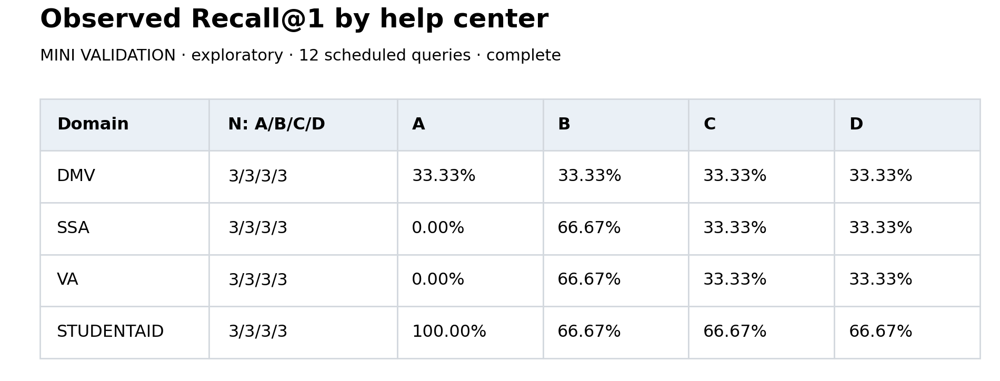

*Table 11. Domain results help inspect examples; each domain contains only three queries.*

One changed answer moves domain recall by 33.3 points. This is an inspection aid, not a basis for a domain-specific deployment rule.

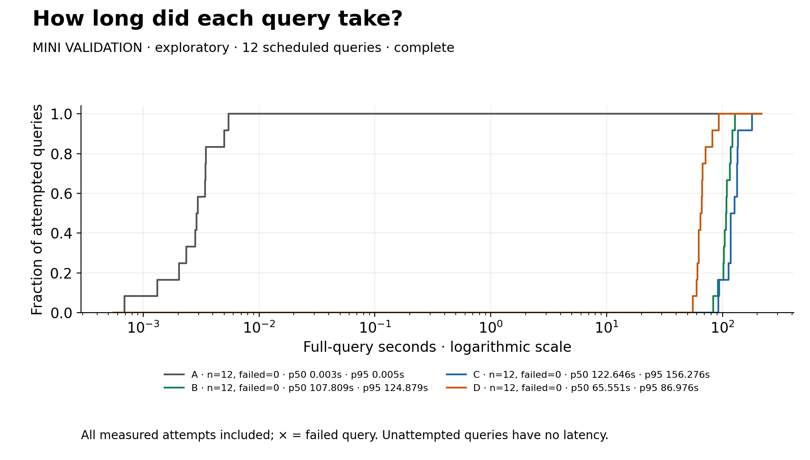

*Graph 12. All attempted query durations; all four methods completed without execution failures.*

The curves expose slower cases that a median hides. They measure retrieval on this setup, not token throughput or total RAG latency. Redrawing them during replay does not make the models faster.

## Closing time

We started with lexical retrieval, added semantic judging, let the judge discover evidence through a hierarchy, then replaced the decision model with an ordinary LLM under common rules.

Adding Nimble judging gave higher observed first-choice recall than BM25. Nimble hierarchy found the target in more ten-passage bundles, but did not give the strongest first choice. Its local end-to-end latency was higher than Qwen's. The workload and tied-score diagnostics qualify that comparison; they do not erase it.

The next useful experiment needs new frozen queries, a broader corpus and a modern dense retrieval/reranking baseline. Any alternative Qwen ranking interface should be developed on training data first. Isolating serving efficiency would require identical candidate states and repeated runs.

We did not reproduce the paper's hosted shared-forward execution or test answer quality. What we did get was a working mechanism, a comparison, and a clearer view of where evidence disappeared. For a test drive, that is useful—even when the machinery does not earn its extra time.

United States of Banan is a reader-supported publication. To receive new posts
and support my work, consider becoming a free or paid subscriber.

[ ✓ Subscribed ]
