# Trick of the tail: testing and forecasting currency extremes

Status: outline anchored to completed live run `runs/20261107T155047630280+0100`, passed fresh-kernel offline replay (`fresh-kernel-validation.json`), direct visual inspection of all 13 single-panel assets (`visual-qa.json`), and independent post-outline review (`post-plan-review.md`). Uses the exact nine narrative headings shared with `trick_of_the_tail.ipynb`. Every numerical claim below comes from retained CSVs and `primary-comparison.json`.

# A tail curve is not a finding

Open with the practitioner trap exposed by our earlier exploratory walkthrough: when a local tail-index estimate climbs during an exchange-rate sell-off, four mechanisms compete—genuine tail-shape change, shifting local volatility scale, clustered extremes inflating variance, or ordinary finite-sample noise. State how this follow-up puts Li and Peng's *Time-Varying Tails: Estimation, Inference, and Risk Measurement* (arXiv:2611.06005v1) to work on real Federal Reserve H.10 daily exchange rates (`EUR/USD`, `GBP/USD`, and reciprocally inverted `JPY/USD`, `1999–2025`, `6,769` signed percentage log losses each; `2,516` in `1999–2008` and `4,253` common scored dates in `2009–2025`), noting explicitly that because `EUR/USD` appeared in the earlier exploratory study it serves as a chronological continuity / temporal pseudo-out-of-sample benchmark alongside previously uninspected `GBP` and `JPY`. State the two distinct empirical questions upfront—retrospective tail-stability inference versus strictly past-only extreme-quantile prediction—and preview the honest, sobering answers: **0/9** baseline stability rejections after Holm multiplicity control, a massive real-time forecasting gain from updating the local threshold (`B` vs `A`), and an **inconclusive** primary gain from updating the tail shape daily (`C` vs `B`). Link `trick_of_the_tail.ipynb` and `sources/2611.06005v1.pdf`, noting that the public arXiv landing page was unavailable during preparation and that synthetic null/power simulations were intentionally omitted to focus exclusively on the real currency panel.

# One threshold and dependent extremes

Explain the mathematical engine concisely for a technical reader: at rescaled time $u \in (0, 1)$, estimate one Epanechnikov-weighted empirical $(1 - q)$ quantile $\hat{b}(u)$ ($q = m/n$, strict exceedances $X_t > \hat{b}(u)$) and average log excesses $\log(X_t/\hat{b}(u))$ above that **same** local threshold (Equations 4.2 and 4.10–4.11). Explain why one common threshold cancels leading local scale shifts inside the window, while serial dependence among clustered exceedances still inflates variance—requiring residualized exceedances $\hat{Z}_t(u)$ and the local Bartlett HAC factor $\hat{S}(u)$ with lag truncation $J = 20$ and floor $0.05$ (Equations 5.2–5.3). Present Table 01 to fix scope and claim boundaries before showing any empirical p-value or forecast score.

> [Insert Table 01 here — Scope and claim boundaries in the empirical study.]

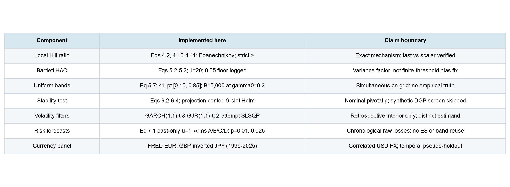

*Proposed caption:* Paper-to-notebook correspondence and explicit claim boundaries under the real-data-only scope.

*Reading to write:* Expected shortfall, joint risk confidence intervals, and synthetic null-size/power Monte Carlo studies are omitted; empirical stability p-values are therefore reported as nominal paper-calibrated pivotal quantities rather than locally certified 5% error rates.

# Can the test control false alarms?

Walk through Equations 6.2–6.4: testing $H_0: \gamma(u) \equiv \gamma_0$ on the 41-point interior grid $[0.15, 0.85]$ centers $\hat{\gamma}(u)$ around the precision-weighted trapezoidal projection $\tilde{\gamma} = (\int \hat{\gamma}(u)/\hat{S}(u)\,du)/(\int 1/\hat{S}(u)\,du)$, integrates squared studentized deviations $T_n$, and scales to $\Lambda_n = mh\,T_n / (\tilde{\gamma}^2 (3/5))$. Explain Remarks 5.3 and 6.1: finite-sample critical values come from `B = 5,000` IID unit-scale Pareto paths $X_t = (1 - U_t)^{-0.3}$ matched to each `(n, m, h, J, grid)` key (`c_{0.95} = 4.0345`, `\Lambda_{0.95} = 1.2395` at baseline `n=6,769, m=200, h=0.10, J=20`). Highlight two vital statistical distinctions: (1) each uniform band multiplier $c_{0.95}$ centers calibration paths at true $\gamma_0 = 0.3$ and is simultaneous across that target's 41 grid points (not familywise across nine series-target pairs), whereas $\Lambda_n$ centers each calibration path at its own estimated $\tilde{\gamma}^{(b)}$; (2) skipping Section 6's synthetic dependent-null simulation screen means local dependent false-alarm rates are unscreened—and in Li and Peng's own Table 3, raw GARCH-t processes reject ~13–14% at nominal 5% before volatility filtering. Frame all empirical stability tests explicitly as nominal paper-calibrated pivotal inferences.

# Raw losses and standardized innovations

Motivate volatility filtering via Section 8 of the paper: persistent conditional volatility clusters raw threshold exceedances even when standardized shocks have a constant heavy tail. Define the three retrospective interior targets per currency—raw signed percentage losses $X_t$, `GARCH(1,1)-t` absolute standardized residuals $|z_t|$, and `GJR-GARCH(1,1)-t` $|z_t|$ fitted to signed returns $r_t = -X_t$ so USD foreign-currency holding losses trigger the asymmetric leverage indicator. Emphasize two guardrails: full-sample filters are strictly retrospective (never used in forecasting), and two-sided innovation magnitudes $|z_t|$ estimate a different tail target than one-sided raw currency losses. Present Table 02: all six filters converged under both SLSQP initialization attempts, reconciled with pure-NumPy variance recursions within `2.66e-15`, yielded persistence `0.9910–0.9991` and Student-t $\hat{\nu}$ between `5.35` (JPY) and `8.83` (GBP), compressed lag-1 absolute autocorrelation from `0.077–0.146` on raw losses to `-0.033` to `+0.007` on `|z_t|`, and triggered `0/41` HAC floor activations anywhere. Note the economically intuitive GJR asymmetry (`gamma[1] > 0` on EUR `+0.011` and GBP `+0.022`, vs `-0.011` on safe-haven JPY).

> [Insert Table 02 here — Volatility filter convergence and local HAC diagnostics.]

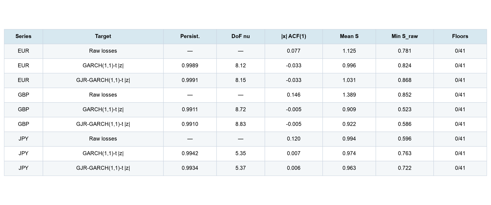

*Proposed caption:* Full-sample GARCH(1,1)-t and GJR-GARCH(1,1)-t parameters, lag-1 absolute autocorrelation, and local Bartlett HAC summaries across EUR, GBP, and JPY.

*Reading to write:* All six volatility filters converged cleanly and compressed lag-1 magnitude dependence near zero while leaving heavy-tailed Student-t shocks (`nu` 5.35 to 8.83) and non-trivial finite-sample Bartlett HAC factors (`Mean S` 0.909 to 1.389).

# Does tail shape stay constant?

Present the three EUR/USD interior `[0.15, 0.85]` curves (Graphs 03, 04, 05, spanning early 2003 through late 2021—`2003-01-17` to `2021-12-08`—in observation time) followed by the full nine-test baseline Holm family (Table 06). Contrast EUR raw losses ($\tilde{\gamma} = 0.239$, path `0.179–0.349`, $\Lambda_n = 0.737$, $p_{\text{raw}} = 0.2430$, $p_{\text{Holm}} = 1.0000$) with EUR `GARCH(1,1)-t` $|z_t|$ ($\tilde{\gamma} = 0.205$, $\Lambda_n = 0.725$, $p_{\text{raw}} = 0.2521$) and `GJR-GARCH(1,1)-t` $|z_t|$ ($\tilde{\gamma} = 0.201$, $\Lambda_n = 0.634$, $p_{\text{raw}} = 0.3305$). Then examine the complete nine-slot table: **0 of 9** tests reject after nine-slot Holm adjustment at $\alpha = 0.05$. Discuss the two unadjusted GBP signals honestly—GBP raw losses ($\tilde{\gamma} = 0.278$, `Mean S = 1.389`, $\Lambda_n = 1.369$, $p_{\text{raw}} = 0.0328$, $p_{\text{Holm}} = 0.2623$) and GBP GJR `|z|` ($\tilde{\gamma} = 0.201$, $\Lambda_n = 1.549$, $p_{\text{raw}} = 0.0200$, $p_{\text{Holm}} = 0.1800$, compared with symmetric GBP GARCH $\Lambda_n = 0.959$, $p_{\text{raw}} = 0.1230$)—alongside quiescent JPY ($\tilde{\gamma} = 0.306$ raw, `0.255` filtered, $p_{\text{raw}} \in [0.4605, 0.6423]$, $p_{\text{Holm}} = 1.0000$). Explain why multiplicity control across correlated USD legs prevents turning isolated raw p-values near 0.02–0.03 into a structural regime story.

> [Insert Graph 03 here — EUR/USD raw positive-loss tail index and 95% HAC band.]

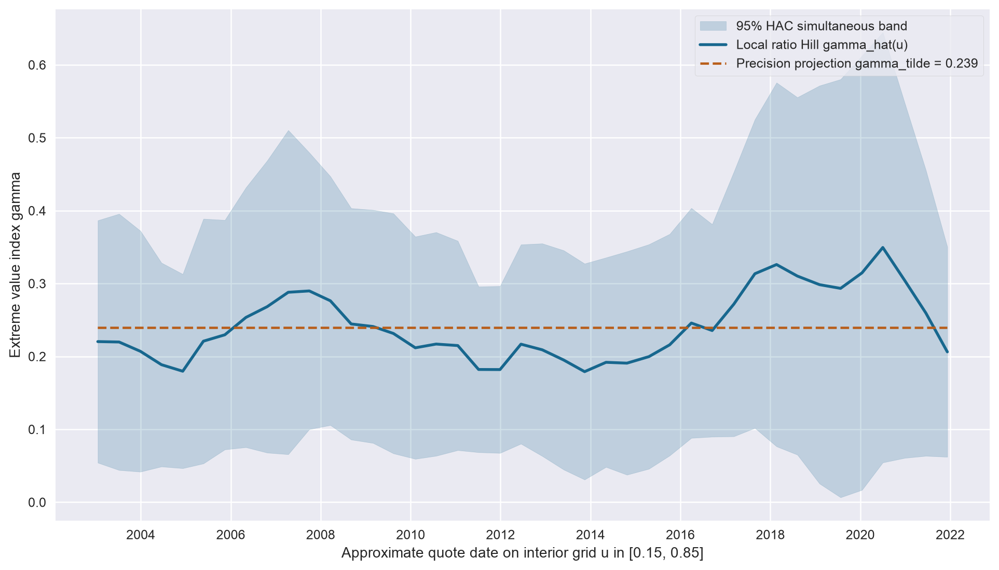

*Proposed caption:* EUR/USD raw upper-loss tail path (`n=6,769, m=200, h=0.10, J=20`): `Lambda_n = 0.737`, raw pivotal `p = 0.2430`, Holm `p = 1.0000`.

*Reading to write:* Two-sided retrospective estimates use observations before and after each displayed date; the wide simultaneous 95% HAC band easily encloses the constant projection `gamma_tilde = 0.239`.

> [Insert Graph 04 here — EUR/USD GARCH(1,1)-t innovation tail index and 95% HAC band.]

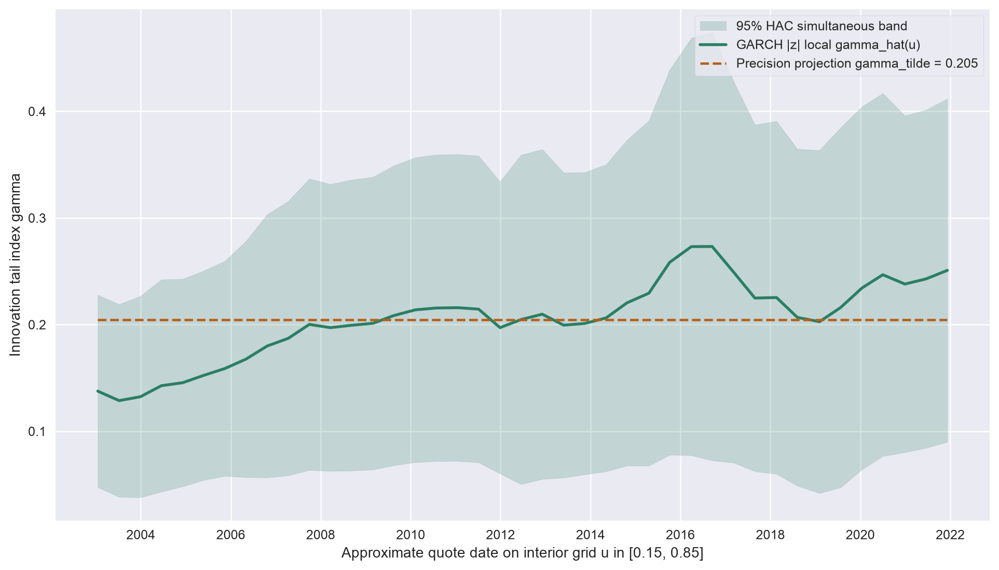

*Proposed caption:* EUR/USD absolute standardized `GARCH(1,1)-t` innovations: `Lambda_n = 0.725`, raw pivotal `p = 0.2521`, Holm `p = 1.0000`.

*Reading to write:* Removing conditional variance clustering shifts the estimand from one-sided currency losses to two-sided shock magnitudes (`gamma_tilde = 0.205`), producing a gentler trajectory without evidence against constancy.

> [Insert Graph 05 here — EUR/USD GJR-GARCH(1,1)-t innovation tail index and 95% HAC band.]

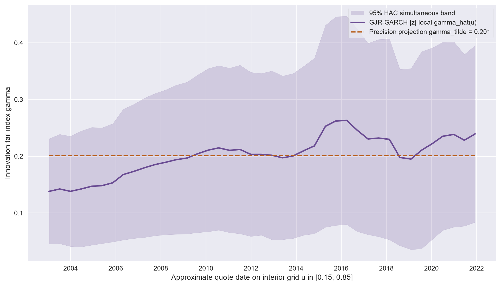

*Proposed caption:* EUR/USD absolute standardized `GJR-GARCH(1,1)-t` innovations: `Lambda_n = 0.634`, raw pivotal `p = 0.3305`, Holm `p = 1.0000`.

*Reading to write:* Allowing asymmetric variance responses to euro-loss shocks leaves the EUR innovation tail path (`gamma_tilde = 0.201`) virtually indistinguishable from symmetric GARCH.

> [Insert Table 06 here — Baseline nine-test tail-stability family.]

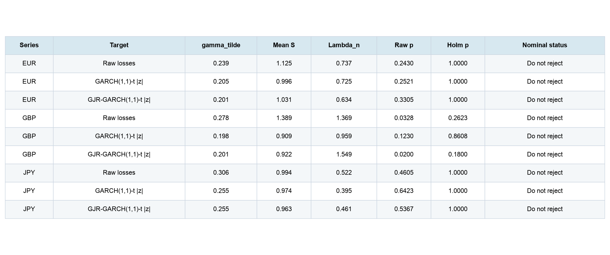

*Proposed caption:* Precision-weighted constant projection `gamma_tilde`, mean Bartlett HAC factor, omnibus statistic `Lambda_n`, raw pivotal p-value, and nine-slot Holm-adjusted p-value (`m=200, h=0.10, J=20`).

*Reading to write:* Zero of nine baseline tests reject at familywise nominal `alpha = 0.05`; GBP raw (`p_raw = 0.0328`) and GBP GJR (`p_raw = 0.0200`) do not survive nine-slot Holm adjustment (`0.2623` and `0.1800`).

# Predict tomorrow using yesterday

Pivot from two-sided retrospective smoothing to strictly chronological one-sided endpoint forecasting (`u = 1`, `m = 200`, `h = 0.10`, $q_t = m/n_t$) on raw signed currency losses. Explain the split: `2,516` losses through `2008-12-31` form the initial prefix; each trading day from `2009-01-02` through `2025-12-31` (`4,253` origins, zero dropped dates) forecasts $\hat{Q}_{t,p} = \hat{b}_t (q_t / p)^{\hat{\gamma}_t}$ using strictly prior observations (`s <= t - 1`). Define the four arms cleanly—Arm A (static `2008-12-31` kernel $\hat{b}_0, q_0, \hat{\gamma}_0$), Arm B (daily kernel $\hat{b}_t, q_t$ with fixed 2008 $\hat{\gamma}_0$), Arm C (daily kernel $\hat{b}_t, q_t, \hat{\gamma}_t$), and Arm D (daily rectangular rolling Hill on the identical endpoint support $|1 - s/n_t| < 0.10$). Present Graph 07 to show why comparing A directly with C would confound crisis-scale decay with tail-shape adaptation: because `2008-12-31` sat inside global financial crisis volatility, static Arm A records only `3` violations in `4,253` days (`0.07%` vs `1%` nominal), whereas Arms B, C, and D adapt local scale immediately.

> [Insert Graph 07 here — EUR/USD rolling 250-day 1% quantile violations (2009-2025).]

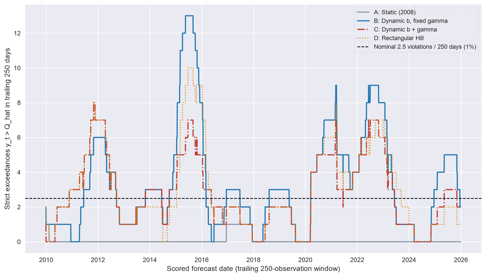

*Proposed caption:* Trailing 250-observation strict violation counts on EUR/USD (`p=0.01`, expanding window) across Arms A, B, C, and D against the nominal 2.5 benchmark.

*Reading to write:* Freezing the 2008 crisis threshold (Arm A) starves exceedances across calmer post-2009 regimes, whereas dynamic thresholding (Arms B, C, and D) tracks changing market scale; violation counts alone do not rank quantile accuracy.

# What does updating shape add?

Focus on the clean experimental isolation between Arm C and Arm B, which share the exact same daily kernel threshold $\hat{b}_t^{\text{ker}}$ and $q_t$ and differ **only** in whether $\hat{\gamma}$ updates daily or stays fixed at `2008-12-31`. Report the predeclared primary contrast (`EUR/USD`, `p = 0.01`, expanding window, `4,253` dates) upfront and without spin:
- Mean daily pinball-loss difference `loss(C) - loss(B) = -0.000224` (`-2.240e-4`, Arm C `0.01688` vs Arm B `0.01711`), **inconclusive** because the paired circular moving-block 95% bootstrap interval straddles zero at every prespecified block length (`L=20`: `[-0.000678, +0.000204]`; `L=10`: `[-0.000685, +0.000198]`; `L=60`: `[-0.000763, +0.000262]`).
- Contrast that modest, noisy shape effect against the overwhelming threshold-adaptation gain `loss(B) - loss(A) = -0.006673` (`L=20` 95% CI `[-0.008087, -0.005061]`, nearly 30 times larger in magnitude!).
- Walk through Graph 08's cumulative anatomy: gradual upward drift during calm `2009`–mid-`2014` and `2017–2019` stretches where fixed 2008 shape slightly beat C, punctuated by sharp downward steps during rare 1%-tail exceedance episodes in late `2014`–early `2015`, `2020`, and `2022` where the `0.99` pinball slope magnifies quantile gaps.
- Walk through Table 09 (`EUR` expanding scores at `p = 0.01` and `p = 0.025`, noting Arm C's `46/4253 = 1.08%` violations and Kupiec `p = 0.598` vs Arm B's `56/4253 = 1.32%`, Kupiec `p = 0.048`, and noting that kernel Arm C beats rectangular Arm D at `p = 0.025` by `-0.000572`, `L=20` CI `[-0.001118, -0.000079]`, while `p = 0.01` `C - D = -0.000117` is inconclusive).
- Walk through Graph 10 and Table 11 across windows and currencies without promoting secondary slices over the primary verdict: on `EUR Rolling-2,500` (`p = 0.01`), `C - B` widens to `-0.000856` (`-8.558e-4`, `L=20` CI `[-18.01e-4, -0.015e-4]`—rounded to `-0.01` at two decimals in Table 11—`L=10` `[-17.82e-4, -0.20e-4]`, while `L=60` slightly crosses zero at `[-18.73e-4, +0.50e-4]`, and `p = 0.025` rolling stays below zero across all three block lengths at `-0.001056`) because under a fixed 2,500-day rolling window $q_t = 200/2500 = 0.08$ stays wider than the expanding window's shrinking $q_t$, giving the $(q_t/p)^{\gamma}$ lever more room to matter when 2008's shape grows stale! Meanwhile `GBP` `C - B` is modestly negative and inconclusive (`-2.558e-4` expanding, `-3.340e-4` rolling), `JPY` `C - B` is slightly **positive** (`+3.354e-4` expanding, `+0.525e-4` rolling, favoring constant 2008 shape), and the `4,253`-date equal-weight 3-FX joint contrast sits near zero (`-0.482e-4` expanding, `-3.791e-4` rolling, both straddling zero).

> [Insert Graph 08 here — Cumulative pinball-loss difference: Arm C minus Arm B (EUR, p=0.01).]

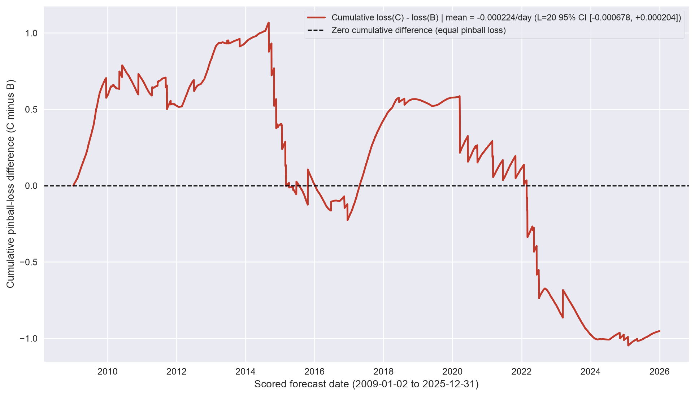

*Proposed caption:* Primary prediction contrast on EUR/USD (`4,253` dates, `p=0.01`, expanding): mean daily `loss(C) - loss(B) = -0.000224`, paired `L=20` block-bootstrap 95% CI `[-0.000678, +0.000204]`.

*Reading to write:* Primary verdict: inconclusive (`95%` block-bootstrap interval straddles zero). Quiet stretches drift gradually while rare 1%-tail exceedance days create abrupt steps that dominate 17-year totals.

> [Insert Table 09 here — EUR/USD expanding-window quantile forecast scores (2009-2025).]

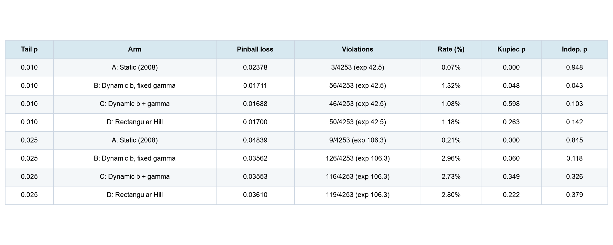

*Proposed caption:* Mean pinball loss, violation counts against nominal expectations, and asymptotic Kupiec unconditional-coverage and Christoffersen independence p-values on EUR/USD (`4,253` origins).

*Reading to write:* Updating the local threshold (`B` vs `A`) cuts `p=0.01` pinball loss from `0.02378` to `0.01711`, whereas differences among dynamic Arms B (`0.01711`), C (`0.01688`), and D (`0.01700`) sit in the fourth decimal place.

> [Insert Graph 10 here — Updating tail shape (Arm C minus Arm B) across windows and currencies.]

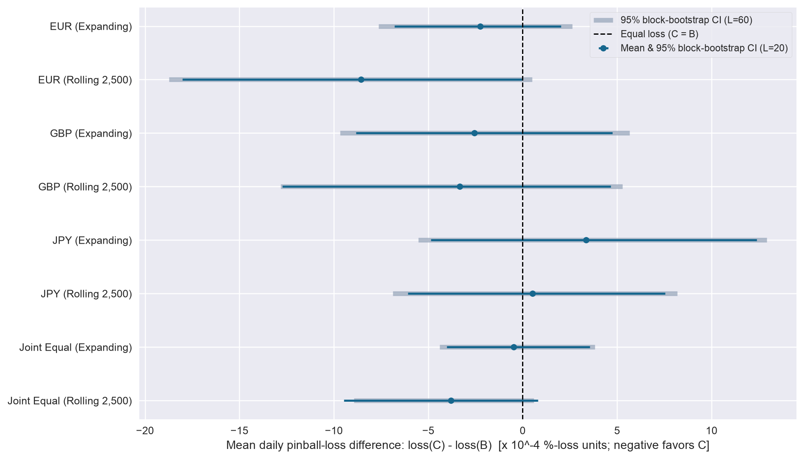

*Proposed caption:* Mean daily pinball-loss difference `loss(C) - loss(B)` at `p=0.01` across EUR, GBP, JPY, and equal-weight common-date joint series for expanding and rolling-2,500 windows (scaled by `10^4`).

*Reading to write:* Across currencies and history rules, paired block-bootstrap intervals straddle zero everywhere at `L=60` (and in seven of eight rows at `L=20`), with JPY leaning slightly toward constant shape.

> [Insert Table 11 here — Supporting currency, window and block-length forecast summary (p=0.01).]

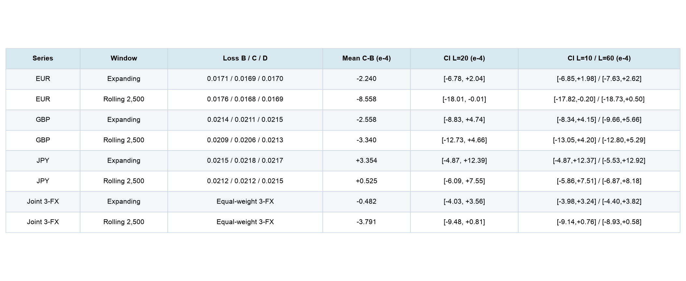

*Proposed caption:* Pinball losses for Arms B, C, and D and paired C-minus-B moving-block bootstrap intervals (`L=20, 10, 60`; `5,000` resamples) across EUR, GBP, JPY, and the `4,253`-date joint panel.

*Reading to write:* Retaining all three currencies, both window rules, and three block lengths prevents promoting EUR Rolling-2,500 (`L=20` upper bound `-0.01e-4`, `L=60` upper bound `+0.50e-4`) over the inconclusive primary expanding contrast.

# Robustness and remaining uncertainty

Close the empirical audit with two retained tables and explicit limitations:
- Table 12: EUR one-factor interior tuning perturbations (`m in {150, 250}`, `h in {0.075, 0.125}`, `J in {10, 30}`) on `[0.15, 0.85]`, each recalibrated with `5,000` independent Pareto paths. Descriptive p-values stay between `0.139` and `0.495` with `0/0/0` floor activations, while band cutoffs $c_{0.95}$ move materially from `3.778` (`h=0.125`) to `4.537` (`h=0.075`) and `4.182` (`J=30`, where $J=30 > mh=20$).
- Table 13: All seven hashed `5,000`-draw calibration caches (`35,000` Pareto paths total) with `1,000`-bootstrap 95% intervals around $c_{0.95}$ and $\Lambda_{0.95}$, plus exact live workload accounting (`117.34s` cold calibration generation; `1.82s` consolidated cached live run on Apple Silicon CPU—`0.01s` cache verification, `0.53s` inference, `1.15s` forecasting—`238.3 MiB` peak RSS, `0` failed filters, `0` failed forecast origins) and passed fresh-kernel offline replay (`26.08s` with network, `arch` fitting, and live generation blocked).
- Re-state what remains open: omitted synthetic dependent-null size/power simulations, omitted expected shortfall and joint `(VaR, ES)` inference, finite-threshold second-order bias on Student-t-like currency innovations, and USD base-leg cross-currency dependence.

> [Insert Table 12 here — EUR/USD interior stability sensitivity across m, h and HAC lag J.]

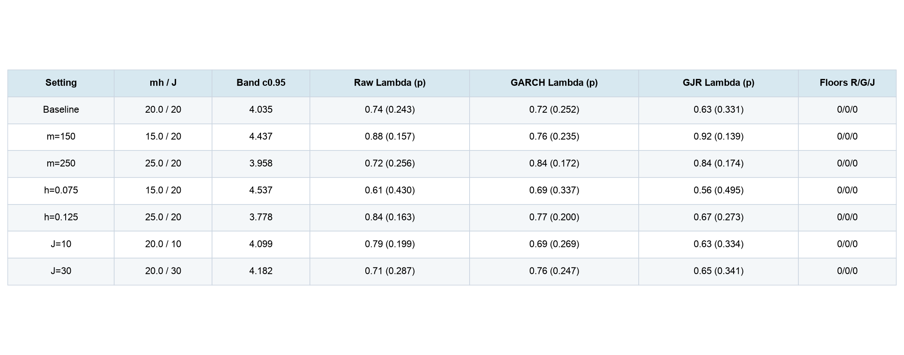

*Proposed caption:* Baseline and six one-factor EUR/USD perturbations on `[0.15, 0.85]`, each recalibrated with `5,000` independent Pareto draws; p-values are descriptive outside the nine-test Holm family.

*Reading to write:* Critical values shift substantially with effective tail sample size `mh` and HAC lag `J`, yet no EUR perturbation approaches rejection (`p` between `0.139` and `0.495`).

> [Insert Table 13 here — Pivotal calibration cutoffs (B=5,000) and cutoff bootstrap uncertainty.]

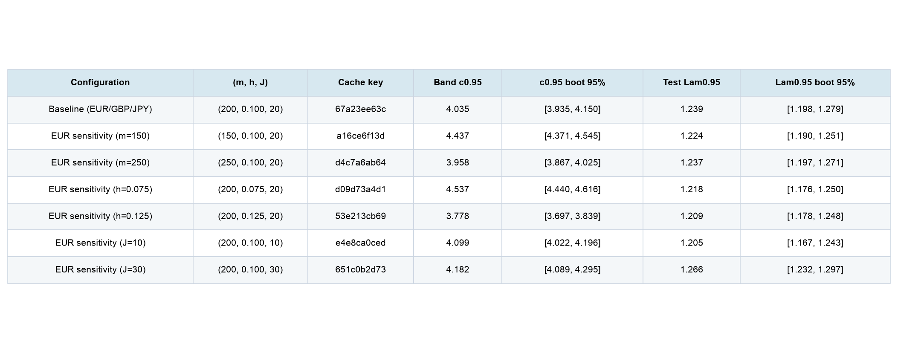

*Proposed caption:* Seven hashed `5,000`-draw Pareto calibration caches (`35,000` paths total) with `1,000`-bootstrap 95% cutoff intervals; live run completed in `1.82s` (`117.34s` cold calibration generation) with `0` filter and `0` forecast failures.

*Reading to write:* Five thousand pivotal draws pin down finite-sample cutoffs tightly relative to empirical estimation noise, and every filter and forecast origin is accounted for without silent drops.

# Closing time

Synthesize the practical takeaway for quantitative researchers and risk teams: separate **scale adaptation**, **tail-shape inference**, and **real-time quantile prediction**. On major USD exchange rates from `1999` to `2025`, updating the local intermediate threshold $\hat{b}_t$ does almost all of the heavy lifting in out-of-sample 1% and 2.5% risk forecasting, while formal HAC-studentized stability tests find zero familywise rejections of constant tail shape and daily $\hat{\gamma}_t$ updates yield at best small, regime-episodic, statistically inconclusive incremental gains on an expanding window. Link `trick_of_the_tail.ipynb`, `validation.md`, and `sources/2611.06005v1.pdf`, and close with the exact `United States of Banan` subscription footer.

